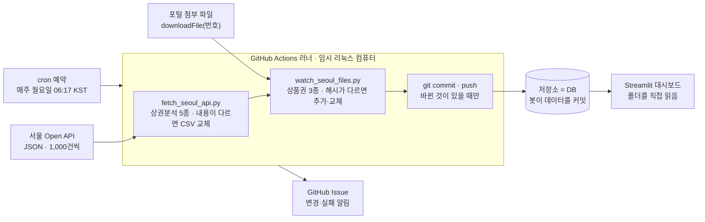

# 서울 데이터 자동 갱신 구조

GitHub가 빌려주는 임시 컴퓨터가 매주 한 번 켜져서, 파이썬 스크립트 두 개로 서울 열린데이터광장의 데이터를 받아 오고, 바뀐 것이 있으면 저장소에 커밋한 뒤 꺼집니다. 개인 서버, AWS, 로컬 컴퓨터는 필요하지 않습니다.

## 한눈에 보기



예약이 러너를 켜면 두 스크립트가 각자의 방식으로 데이터를 받고, 바뀐 것이 있을 때만 저장소에 커밋합니다. 대시보드는 그 저장소 폴더를 읽습니다.

## 어디서, 언제 도는가

GitHub Actions라는 GitHub의 기능 위에서 돕니다. 실행할 때마다 GitHub가 새 리눅스 가상 컴퓨터(러너)를 하나 만들어 주고, 일이 끝나면 통째로 지웁니다. 항상 켜져 있는 서버가 아닙니다.

| 질문 | 답 |
| --- | --- |
| 개인 서버가 있나 | 없음 |
| AWS 같은 클라우드를 따로 쓰나 | 안 씀. GitHub가 자기 클라우드에서 실행 |
| 로컬 컴퓨터에서 돌려야 하나 | 아님. 컴퓨터가 꺼져 있어도 실행됨 |
| 비용 | 공개 저장소는 무료 |
| 러너 종류 | `runs-on: ubuntu-latest` (우분투 리눅스) |
| 실행 제한 시간 | 60분 (`timeout-minutes: 60`) |

실행 계기는 워크플로 파일 `.github/workflows/update-seoul-data.yml`의 `on:` 부분이 정합니다.

| 조건 | 뜻 | 비고 |
| --- | --- | --- |
| `schedule: cron "17 21 * * 0"` | 매주 일요일 21:17 UTC = 월요일 06:17 KST | 워크플로가 main에 있어야 동작 |
| `workflow_dispatch` | Actions 탭의 버튼으로 수동 실행 | 워크플로가 main에 있어야 버튼이 보임 |

cron은 "분 시 일 월 요일" 순서의 예약 표기법입니다. GitHub 서버 시계가 UTC라서 한국 시각에서 9시간을 빼서 적습니다. 예약 실행은 GitHub 사정에 따라 수십 분 늦게 시작될 수 있습니다.

## 한 번 실행의 순서

러너는 매번 빈 컴퓨터에서 시작하므로 준비 과정부터 반복합니다. 4번과 5번이 데이터를 가져오는 단계이고, 가져오는 방식이 서로 다릅니다.

1. 러너가 켜진다.
2. 저장소 코드를 내려받는다 (`actions/checkout`).
3. 파이썬 3.12와 라이브러리를 설치한다 (`requests`, `python-dotenv`, `pandas`, `openpyxl`).
4. `scripts/fetch_seoul_api.py`를 실행한다. 상권분석 5종을 Open API로 받는다.
5. `scripts/watch_seoul_files.py`를 실행한다. 상품권 3종의 첨부 파일을 확인한다.
6. 이번 달을 적은 파일(`_meta/last_checked_month.txt`)을 갱신한다.
7. `data/raw/seoul_trading_area`에 바뀐 것이 있으면 커밋하고 push한다. 없으면 "변경 없음"만 출력한다.
8. 알릴 내용이 있으면 GitHub Issue를 만들고, 러너가 사라진다.

5~8번에는 `if: always()`가 붙어 있어 앞 단계가 실패해도 실행됩니다. API가 응답하지 않는 날에도 상품권 확인은 돌고, 성공한 부분은 커밋됩니다.

## 상권분석 5종: Open API 호출

이쪽은 웹페이지를 긁지 않습니다. 서울시가 프로그램용으로 열어 둔 공식 창구(Open API)에 요청하고, HTML이 아닌 JSON으로 답을 받습니다. 담당 스크립트는 `scripts/fetch_seoul_api.py`, 설정은 `scripts/seoul_api.json`입니다.

요청 주소의 모양은 다음과 같습니다.

```
http://openapi.seoul.go.kr:8088/{인증키}/json/{서비스명}/{시작행}/{끝행}/
```

| 데이터셋 | 서비스명 | 포털 페이지 |
| --- | --- | --- |
| 추정매출-자치구 | `VwsmSignguSelngW` | [OA-22176](https://data.seoul.go.kr/dataList/OA-22176/S/1/datasetView.do) |
| 점포-자치구 | `VwsmSignguStorW` | [OA-22173](https://data.seoul.go.kr/dataList/OA-22173/S/1/datasetView.do) |
| 직장인구-자치구 | `VwsmSignguWrcPopltnW` | [OA-22185](https://data.seoul.go.kr/dataList/OA-22185/S/1/datasetView.do) |
| 길단위인구-자치구 | `VwsmSignguFlpopW` | [OA-22179](https://data.seoul.go.kr/dataList/OA-22179/S/1/datasetView.do) |
| 상권변화지표-자치구 | `VwsmSignguIxQq` | [OA-15567](https://data.seoul.go.kr/dataList/OA-15567/S/1/datasetView.do) |

응답에는 전체 건수(`list_total_count`), 결과 코드(`RESULT.CODE`), 실제 데이터(`row`)가 들어 있습니다. 데이터셋마다 아래 순서로 처리합니다.

1. **나눠 받기**: 한 번에 1,000건까지만 주므로 1~1000, 1001~2000 식으로 전체 건수를 채울 때까지 반복한다.
2. **검사**: 건수가 지난번의 90% 밑으로 줄지 않았는지, 25개 자치구가 모두 있는지, 분기 코드가 `20262` 형태인지 확인한다. 하나라도 걸리면 기존 파일을 건드리지 않는다.
3. **이름 바꾸기**: API의 영문 필드명(`THSMON_SELNG_AMT`)을 대시보드가 읽는 한글 열 이름(`당월_매출_금액`)으로 바꾼다. 대응표는 `seoul_api.json`의 `columns`다.
4. **비교 후 교체**: 새로 만든 CSV가 지금 파일과 한 글자라도 다르면 교체하고, 같으면 그대로 둔다.

이 API에는 특정 분기만 받는 옵션이 없어서 매번 전 기간을 받아 통째로 비교합니다. 2번의 90% 검사는 응답이 중간에 잘려 과거 분기가 사라지는 일을 막는 장치입니다.

인증키는 코드에 적지 않고 저장소의 Secrets에 `SEOUL_API_KEY`로 넣습니다. 실행할 때만 러너에 전달되고, 로그에는 `***`로 가려집니다. 키가 주소 안에 들어가는 방식이라 스크립트도 오류가 났을 때 주소를 출력하지 않습니다.

## 상품권 3종: 웹페이지에서 찾아 내려받기

결제내역, 발행·판매 현황, 가맹점은 API가 없고 담당자가 게시글에 엑셀을 첨부합니다. 그래서 사람이 브라우저로 하는 일을 흉내 냅니다. 이 부분이 스크래핑에 해당합니다. 담당 스크립트는 `scripts/watch_seoul_files.py`, 설정은 `scripts/seoul_files.json`입니다.

### 1. 페이지 HTML 받기

브라우저를 띄우지 않고 `requests` 라이브러리로 HTML 원문만 받습니다.

```
GET https://data.seoul.go.kr/dataList/OA-22395/F/1/datasetView.do
```

### 2. 첨부 파일 목록 찾기: 무엇을 지정해서 찾는가

특정 태그나 클래스를 지정하지 않습니다. 내려받기 버튼에 걸린 자바스크립트 호출문 `downloadFile('12')`를 HTML 전체에서 정규식으로 찾습니다. 괄호 안 숫자가 첨부 파일의 번호입니다.

```python
CALL_RE = re.compile(r"downloadFile\(\s*['\"]?(\d+)['\"]?\s*\)")
```

태그 대신 이 방식을 쓰는 이유는 두 가지입니다.

- 태그 구조나 클래스 이름은 디자인 개편 때 쉽게 바뀌지만, 다운로드를 일으키는 함수 호출은 기능 자체라 덜 바뀐다.
- 버튼의 `a::after`는 아이콘을 그리는 꾸밈 요소라 데이터가 없다. 실제 정보는 그 `<a>` 태그에 걸린 `downloadFile(번호)`에 있다.

### 3. 번호에 파일명 짝짓기

번호 근처의 글자에서 `.xlsx`, `.csv`, `.zip` 등으로 끝나는 문자열을 찾습니다. 버튼 안쪽에 있으면 그것을 쓰고, 없으면 바로 앞 버튼과 이 버튼 사이의 글자에서 찾습니다. 결과는 `(12, "26년03월 자치구별 업종별 서울사랑상품권 결제내역.xlsx")` 같은 목록입니다.

### 4. 감시 대상 고르기

| 대상 | 포털 페이지 | 고르는 기준 | 방식 |
| --- | --- | --- | --- |
| 결제내역 | [OA-22395](https://data.seoul.go.kr/dataList/OA-22395/F/1/datasetView.do) | `NN년NN월 … 결제내역.xlsx` 또는 `NNNN년 … 결제내역.zip` | 해당하는 파일 전부 |
| 발행·판매 현황 | [OA-22395](https://data.seoul.go.kr/dataList/OA-22395/F/1/datasetView.do) | `월별 서울사랑상품권 발행 및 판매 현황….xlsx` | 번호가 가장 큰 것 하나 |
| 가맹점 | [OA-21099](https://data.seoul.go.kr/dataList/OA-21099/F/1/datasetView.do) | 이름에 `가맹점` | 번호가 가장 큰 것 하나 |

### 5. 내려받기

버튼을 누를 때 브라우저가 보내는 요청을 그대로 보냅니다. `infId`는 데이터셋 번호, `seq`는 2단계에서 찾은 파일 번호입니다.

```
POST https://datafile.seoul.go.kr/bigfile/iot/inf/nio_download.do?&useCache=false
보내는 값: infId=OA-22395, seq=12, infSeq=1, seqNo=(빈값)
```

요청이 틀리면 포털이 성공 응답으로 오류 안내 HTML을 줍니다. 받은 내용의 앞부분이 HTML이면 실패로 처리합니다.

### 6. 바뀌었는지 판단: 해시 비교

받은 파일의 SHA-256 해시를 계산해 지난번 기록과 비교합니다. 해시는 파일 내용으로 만든 64자리 지문이고, 내용이 한 글자만 달라도 완전히 달라집니다. 같으면 건너뛰고, 다르면 다음 단계로 갑니다. 번호나 파일명이 아닌 내용을 비교하는 이유는 포털이 같은 자리의 파일을 이름도 바꾸지 않고 교체하는 경우가 있기 때문입니다.

### 7. 검사와 변환 후 저장

| 대상 | 검사 | 저장 |
| --- | --- | --- |
| 결제내역 | 자치구 25개가 한 줄씩 있는지, 이름 없는 열이 없는지 | `gift_payment/연도/원래 파일명`. zip은 풀어서 월별로 |
| 발행·판매 현황 | `24년4월` 형태의 시트가 있는지 | `gift_issue/`에 고정 이름으로 덮어쓰기 |
| 가맹점 | `자치구명`, `서울페이업종명` 열이 있는지 | 두 열만 남긴 CSV로 바꿔 `gift_merchant/`에 덮어쓰기 |

검사에서 걸리면 기존 파일을 건드리지 않고 사유를 기록합니다. 결제내역이 업종마다 건수와 금액 네 열로 나뉜 상세 형식으로 올라오면 `순결제액 = 금액(A) - 금액(B)`로 계산해 다른 달과 같은 형식으로 바꿉니다. 26년 1월 파일이 이 경우입니다.

## 기억과 저장: 저장소가 데이터베이스

러너는 매번 지워지므로 데이터도, "지난번에 무엇을 봤는지"도 저장소에 파일로 남깁니다. 모두 `data/raw/seoul_trading_area/` 아래에 있습니다.

| 폴더 | 내용 | 갱신 방식 |
| --- | --- | --- |
| `trading_area/` | 상권분석 CSV 5개 | 내용이 바뀌면 교체 |
| `gift_payment/연도/` | 결제내역 월별 xlsx | 새 달이 올라오면 추가 |
| `gift_issue/` | 발행·판매 현황 1개 | 내용이 바뀌면 교체 |
| `gift_merchant/` | 가맹점 CSV 1개 | 새 기준일 파일로 교체 |
| `_meta/` | 자동 갱신 기록 3개 | 스크립트가 관리 |

`_meta/`의 세 파일은 다음과 같습니다.

| 파일 | 내용 | 쓰임 |
| --- | --- | --- |
| `api_index.json` | 상권분석 데이터셋별 건수와 분기 범위 | 건수 급감 검사, 새 분기 알림 |
| `file_watch_state.json` | 첨부 파일명별 마지막으로 처리한 해시 | 같은 파일을 다시 처리하지 않기 |
| `last_checked_month.txt` | 이번 달 (예: `2026-10`) | 예약 실행 꺼짐 방지 |

마지막 파일이 필요한 이유는 GitHub가 60일간 활동이 없는 저장소의 예약 실행을 끄기 때문입니다. 달이 바뀔 때마다 이 파일이 달라져 커밋이 생기므로, 데이터가 오래 바뀌지 않아도 예약이 유지됩니다.

저장소에 반영할 때는 러너 안에서 평범한 git 명령(`git add`, `git commit`, `git push`)을 씁니다. push 권한은 워크플로의 `permissions: contents: write`에서 나오고, GitHub가 실행마다 임시 출입증(`GITHUB_TOKEN`)을 발급합니다. 커밋 작성자가 `github-actions[bot]`으로 찍히는 이유입니다.

## 알림과 대시보드 반영

두 스크립트는 바뀐 내용이나 실패 사유를 `update_report.md`에 적습니다. 워크플로의 마지막 단계가 이 파일이 있을 때만 그 내용으로 GitHub Issue를 만들고, 저장소를 Watch하는 사람에게 메일이 갑니다. 아무 일도 없던 주에는 Issue도 없습니다.

| 상황 | 일어나는 일 | 사람이 할 일 |
| --- | --- | --- |
| 새 데이터가 정상 반영됨 | 커밋 + "무엇이 바뀌었는지" Issue | 없음 |
| 바뀐 것이 없음 | 커밋도 Issue도 없음 | 없음 |
| 파일 형식이 바뀌어 검사에서 걸림 | 기존 파일 유지 + "자동 반영 실패" Issue | 포털 파일을 확인하고 설정이나 스크립트 수정 |
| 포털 개편으로 목록을 못 읽음 | 워크플로 실패 + Issue | 스크립트 수정 |

대시보드(`streamlit_demo/pages/1_대시보드.py`)는 `data/raw/seoul_trading_area` 폴더를 직접 읽습니다. 봇이 커밋하는 브랜치와 Streamlit 배포가 연결된 브랜치가 같으면, 커밋 직후 앱이 새 데이터로 다시 뜹니다.

## 로컬에서 확인하는 법

저장소 최상위에 `.env` 파일을 만들고 `SEOUL_API_KEY=발급받은키`를 넣은 뒤 실행합니다.

```bash
pip install requests python-dotenv pandas openpyxl

python scripts/fetch_seoul_api.py --check     # 저장 없이 API 서비스명·필드 매핑만 확인
python scripts/watch_seoul_files.py --list    # 포털 첨부 파일 목록을 제대로 읽는지 확인
python scripts/watch_seoul_files.py --test    # 대상별 최신 파일 1개를 _watch_test/에 시험 다운로드

python scripts/fetch_seoul_api.py             # 실제 수집 (data/raw 변경됨)
python scripts/watch_seoul_files.py           # 실제 감시 (data/raw 변경됨)
```

## 한계

이 방식이 보장하는 것은 "오류가 없다"가 아니라, 예상한 형식이면 자동으로 반영하고 예상과 다르면 기존 데이터를 지키면서 알린다는 것입니다.

- **실시간이 아니다.** 주 1회 확인이고, 예약 시각도 수십 분 밀릴 수 있다.
- **상품권 쪽은 포털에 의존한다.** 페이지 구조나 다운로드 요청 형식이 바뀌면 깨진다. Issue로 알려 줄 뿐 스스로 고치지는 못한다.
- **사람이 올리는 파일은 형식이 바뀐다.** 26년 1월 결제내역이 다른 달과 다른 형식으로 올라온 것이 실제 사례다.
- **저장소 용량이 늘어난다.** 데이터 파일이 바뀔 때마다 이전 판이 git 기록에 남는다.
- **읽기 전용 데이터에만 맞는다.** 사용자가 데이터를 써넣는 서비스에는 쓸 수 없다.

## 자주 받을 질문

| 질문 | 답 |
| --- | --- |
| 어디서 도나 | GitHub Actions가 빌려주는 임시 리눅스 컴퓨터 |
| 누가 켜나 | cron 예약 (매주 월요일 06:17 KST) |
| 서버나 AWS가 필요한가 | 필요 없음. 공개 저장소는 무료 |
| 데이터는 어떻게 받나 | 상권분석은 공식 API, 상품권은 페이지에서 `downloadFile(번호)`를 찾아 같은 요청을 보냄 |
| 어떤 태그를 지정하나 | 태그가 아니라 버튼의 함수 호출문을 정규식으로 찾음 |
| 바뀐 것을 어떻게 아나 | 상권분석은 CSV 내용 비교, 상품권은 파일 해시 비교 |
| 어디에 저장하나 | 저장소에 커밋. 저장소가 데이터베이스 역할 |
| 인증키는 어디에 두나 | 저장소 Secrets의 `SEOUL_API_KEY` |
| 실패하면 | 기존 데이터를 유지하고 Issue로 알림 |
| 무한히 도는 것 아닌가 | 아님. 한 번 확인하고 종료. 60분 제한도 있음 |
